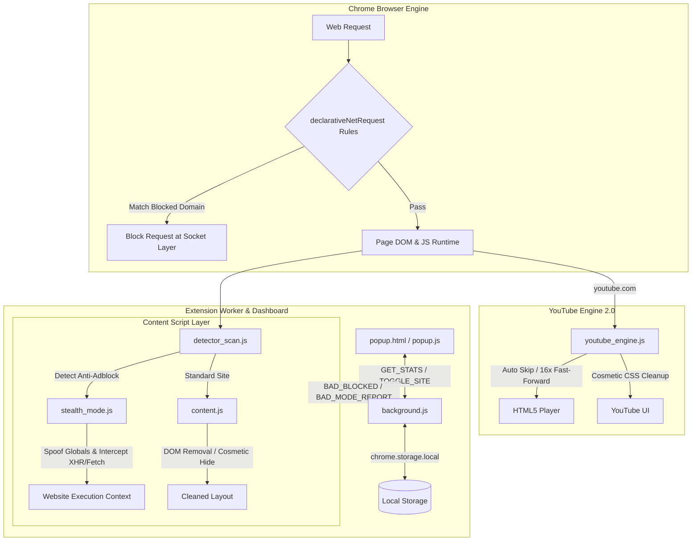

# b-AD v3.0 — Smart Ad & Tracker Blocker


> **b-AD** is an enterprise-grade, high-performance Chrome extension designed to block ads, tracking scripts, telemetry, and popups while evading anti-adblock detection scripts and automatically skipping YouTube video ads.

---

## 🌟 Overview

Modern websites rely on aggressive ad networks, session recorders, heatmaps, and sophisticated anti-adblock detectors. **b-AD v3.0** operates across multiple browser layers simultaneously:

- **Network-Level Blocking**: Uses 50 declarative `declarativeNetRequest` rules to neutralize ad servers and trackers before requests reach the socket layer with **zero CPU overhead**.
- **DOM Cosmetic Filtering**: Removes ad banners, sponsored containers, and native ad widgets without altering page layouts.
- **Stealth Evasion Engine**: Dynamically detects anti-adblock scripts (`FuckAdBlock`, `AdNgine`, bait height checks) and spoofs window parameters, returning fake 200 OK responses to ad pings.
- **YouTube Engine 2.0**: Dedicated video player controller that auto-skips video ads, speeds up unskippable ads 16x, mutes ad audio, and removes display banners.
- **Glassmorphic Telemetry Dashboard**: A dark-mode UI with live metric counters, tabbed domain intelligence with category tags, per-site pause toggles, and instant analytics search.

---

## 🏗️ System Architecture



---

## 🔥 Key Features

### 1. 🛡️ Dual-Layer Blocking System
- **50 Declarative Net Rules**: Blocks Google DoubleClick, AdSense, Amazon Ads, Taboola, Outbrain, Criteo, TikTok Ads, Bing Ads, PopAds, and crypto miners before network resolution.
- **Tracker Neutralization**: Neutralizes Google Analytics, Tag Manager, Facebook Pixel, Hotjar, Microsoft Clarity, FullStory, Mixpanel, Segment, Amplitude, and Yandex Metrika.

### 2. 🥷 Stealth Evasion Mode
- **Window Property Spoofing**: Exposes valid `canRunAds = true`, `adsbygoogle.loaded = true`, `google_jobrunner = true` to defeat inline detection routines.
- **Ad Ping Hooking**: Intercepts `XMLHttpRequest` and `fetch` calls to known ad beacons, resolving them silently with fake `200 OK` status codes.
- **Bait Height Spoofing**: Intercepts `HTMLElement.prototype.offsetHeight` for bait elements (`adsbox`, `ad-placement`), returning non-zero values to trick height-check algorithms.

### 3. 🎥 YouTube Engine 2.0
- **Auto-Skipping**: Instantly triggers `.ytp-ad-skip-button` and `.ytp-ad-skip-button-modern` buttons as soon as they spawn.
- **Instant Seek & Fast-Forward**: If an ad is unskippable, jumps `video.currentTime = video.duration` and temporarily accelerates playback to `16x` while muting audio.
- **Audio Restoration Guard**: Automatically restores normal playback speed (`1x`) and audio once the main video resumes.
- **Display Ad Cleaner**: Hides masthead ads, video overlays, companion banners, and Shorts sponsored shelves via injected high-priority CSS rules.

### 4. 📊 Glassmorphic Analytics Dashboard
- **Live Stats Overview**: Tracks total ads blocked, trackers neutralized, estimated bandwidth saved, and top ad sources.
- **Domain Intelligence Tab**: Interactive, searchable list of blocked domains with rank counters, category badges (*Analytics*, *Ad Network*, *Heatmaps*, *Social Tracking*), and percentage fill bars.
- **Per-Site & Global Toggle**: One-click pause switch to disable protection globally or whitelist the currently active domain.

---

## 📂 Project Structure

```
b-ad-v3/
├── manifest.json          # Chrome Extension Manifest V3 configuration
├── background.js          # Background Service Worker — state & telemetry manager
├── content.js             # DOM ad scanner, cosmetic filter, and observer
├── detector_scan.js       # Anti-adblock detector engine & mode classifier
├── stealth_mode.js        # Global property spoofer & XHR/fetch network hook
├── youtube_engine.js      # Dedicated YouTube video ad skipper & layout cleaner
├── rules.json             # 50 declarativeNetRequest V3 blocking rules
├── tracker_list.json      # Categorized reference database for telemetry UI
├── popup.html             # Multi-tab glassmorphic popup dashboard
├── popup.css              # Industrial dark theme design system & micro-animations
├── popup.js               # Dashboard state controller & domain intelligence search
└── README.md              # Project documentation
```

---

## 🚀 Installation Guide

### Loading Unpacked Extension in Chrome

1. Clone or download this repository to your local machine:
   ```bash
   git clone https://github.com/your-username/b-ad-v3.git
   ```
2. Open Chrome and navigate to `chrome://extensions`.
3. Enable **Developer mode** in the top-right corner.
4. Click **Load unpacked** in the top-left toolbar.
5. Select the `b-ad-v3/` root folder.
6. **b-AD** is now installed and active! Pin the extension to your toolbar to open the live dashboard.

---

## 🔒 Privacy & Performance

- **100% Local Storage**: All telemetry (counts, bandwidth saved, domain lists) is stored exclusively on your device in `chrome.storage.local`.
- **Zero Analytics / No Remote Servers**: b-AD never makes any external network requests or transmits user data to remote endpoints.
- **Zero Overhead**: Declarative rules run at the native browser engine level, resulting in 0ms main-thread scripting delay during page navigation.

---

## 📜 License

This project is licensed under the **MIT License** — see the [LICENSE](LICENSE) file for details.
