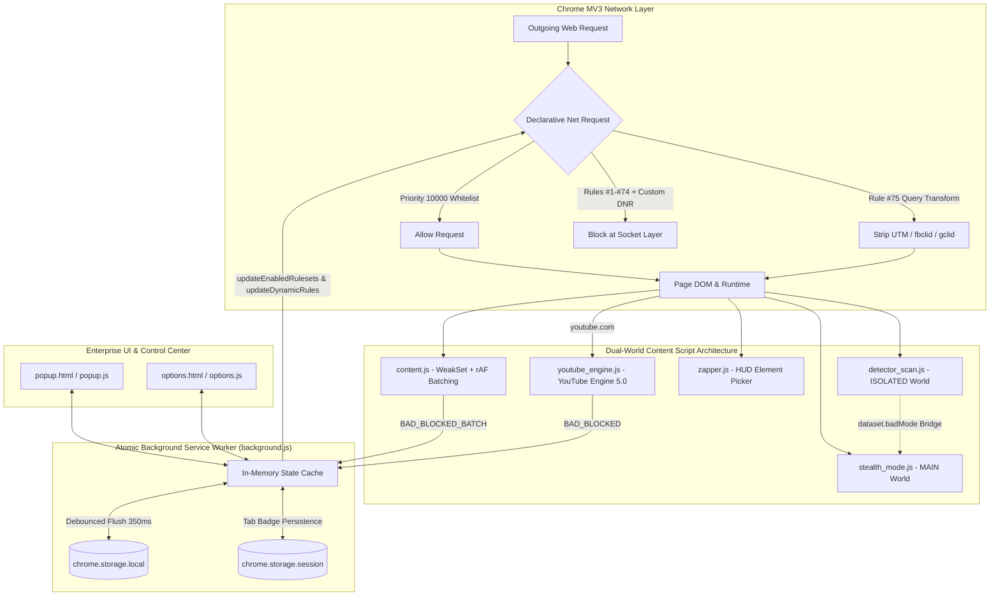

# b-AD Ultra v5.0 Enterprise — Next-Gen Manifest V3 Ad, Tracker & Privacy Suite


> **b-AD Ultra v5.0 Enterprise** is a production-hardened Chrome Manifest V3 privacy, ad-blocking, and anti-fingerprinting extension. Built with an atomic state engine, true `MAIN`-world anti-adblock evasion, bidirectional Declarative Net Request (DNR) synchronization, YouTube Engine 5.0 with SponsorBlock HUD, and an interactive Visual Element Zapper.

---

## 🚀 What's New in Version 5.0 Enterprise

1. **🥷 True `MAIN`-World Stealth & Offscreen Canvas Shield (`stealth_mode.js`)**
   - Injected directly into the page's `MAIN` execution world at `document_start` via Chrome MV3 native world isolation (`"world": "MAIN"`).
   - Non-destructive **offscreen canvas cloning** applies session-seeded sub-pixel noise to `toDataURL` without altering visible on-screen canvas pixels.
   - Dispatches spec-compliant `Event("readystatechange")` and `ProgressEvent("load")` on intercepted anti-adblock XHR/Fetch probes and spoofs bait geometry (`offsetHeight`, `offsetWidth`, `getComputedStyle`) plus Google Publisher Tag (`googletag`), AdSense (`adsbygoogle`), and Prebid (`pbjs`) stubs.

2. **⚡ Atomic State Cache & True DNR Whitelist Synchronization (`background.js`)**
   - Eliminates concurrent storage race conditions (`lost updates`) via an in-memory state cache paired with a debounced storage flush queue (`350ms`) and `chrome.storage.session` per-tab counters that survive MV3 service worker sleep cycles.
   - Toggling **Global Protection** dynamically enables/disables the static `ad_block_rules` ruleset via `chrome.declarativeNetRequest.updateEnabledRulesets`.
   - Pausing a site (**Trusted Whitelist**) dynamically injects priority-`10000` `allow` / `allowAllRequests` DNR rules in reserved ID space `900001+` so whitelisted sites genuinely bypass socket-level blocking.

3. **🛡️ Expanded 75-Rule DNR Engine + URL Tracking Parameter Stripper (`rules.json`)**
   - Expanded static ruleset covering 74 ad exchanges, analytics beacons, session replay scripts, malvertising popunders, and cryptojackers, plus Rule `#75` which automatically strips 18 tracking query parameters (`utm_source`, `utm_medium`, `utm_campaign`, `fbclid`, `gclid`, `msclkid`, `twclid`, `ttclid`, `mc_eid`, `igshid`, etc.) on navigation.

4. **🎥 YouTube Engine 5.0 (`youtube_engine.js`)**
   - **User Audio & Speed Preservation**: Tracks `mutedByEngine` and `userPlaybackRate` so user-initiated mute or custom playback speeds (`1.25x`, `1.5x`, `2x`) are never clobbered after an ad finishes.
   - **Event-Driven Architecture**: Uses `yt-navigate-finish`, video `timeupdate` events, and targeted player attribute observers with a 4-second `AbortController` timeout and LRU cache for SponsorBlock segments, plus on-player HUD skip toasts.

5. **🎯 Viewport-Clamped Element Zapper HUD (`zapper.js`)**
   - Floating HUD pill with live element dimension tags, automatic viewport edge clamping, and **`↑` / `↓` Arrow Key traversal** to expand selection to parent containers or drill into child nodes before zapping.

6. **🔒 Hardened CSS & Configuration Security (`content.js`, `options.js`)**
   - Isolates core ad/GDPR styles from custom user selectors and validates every custom CSS selector via a detached `DocumentFragment` (`querySelector`) while blocking CSS injection tokens (`{`, `}`, `;`, `@import`, `url(`).
   - Deduplicates DOM nodes via `WeakSet`, batches mutations with `requestAnimationFrame`, and aggregates IPC telemetry (`BAD_BLOCKED_BATCH`).

---

## 🏗️ System Architecture (v5.0 Enterprise)



---

## 📂 Repository Structure

```text
b-ad-v5/
├── manifest.json          # Manifest V3 v5.0.0 (MAIN world stealth, CSP, DNR, commands)
├── background.js          # Atomic state cache, debounced storage, DNR allow/block sync
├── content.js             # WeakSet DOM ad/GDPR cleaner, isolated CSS validation, rAF batching
├── stealth_mode.js        # MAIN-world anti-adblock spoofer & offscreen canvas noise shield
├── detector_scan.js       # Anti-adblock detector & ISOLATED-to-MAIN dataset bridge
├── youtube_engine.js      # YouTube Engine 5.0 (SponsorBlock LRU cache, HUD toast, audio-safe)
├── zapper.js              # Visual Element Zapper HUD with ArrowUp/ArrowDown DOM traversal
├── rules.json             # 75 static DNR rules (ad networks, trackers, URL param stripper)
├── tracker_list.json      # 69 categorized tracker signatures with threat risk ratings
├── popup.html             # 4-tab enterprise popup with Quick Rule drawer & Live Log
├── popup.css              # Enterprise dark glassmorphic styling
├── popup.js               # Popup controller with two-step reset & real-time module toggles
├── options.html           # Full-page Enterprise Control Center with KPI strip & Rules Explorer
├── options.css            # Control Center stylesheet with toast notifications
├── options.js             # Schema-validated config import/export & rule management controller
├── icons/                 # Extension toolbar & store icons (16px, 48px, 128px)
├── LICENSE                # MIT License
└── README.md              # Architecture & usage documentation
```

---

## 🛠️ Installation & Usage

1. Open Google Chrome or any Chromium-based browser and navigate to `chrome://extensions`.
2. Enable **Developer mode** in the top-right corner.
3. Click **Load unpacked** and select the `b-ad-v5/` directory.
4. Pin **b-AD Ultra** to your browser toolbar:
   - Press `Ctrl+Shift+Z` (`Cmd+Shift+Z` on macOS) on any page to launch the **Visual Element Zapper HUD**.
   - Press `Alt+Shift+P` to quickly pause or resume protection on the active site.

---

## 📜 License

MIT License
