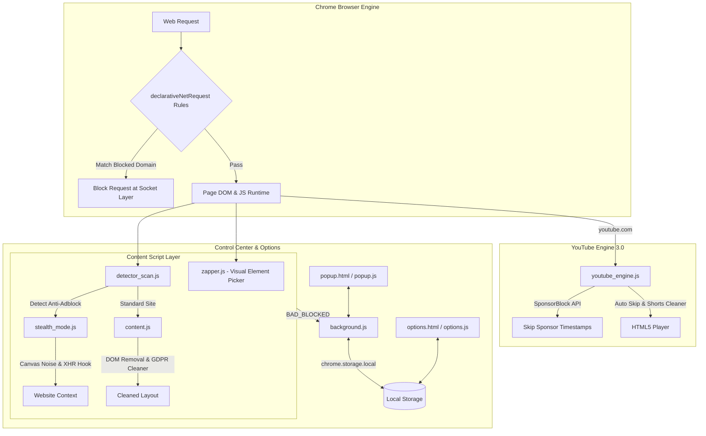

# b-AD Ultra v4.0 — Next-Gen Ad, Tracker & Privacy Suite


> **b-AD Ultra v4.0** is an enterprise-grade Chrome Manifest V3 privacy suite with dynamic DNR network blocking, anti-adblock stealth evasion, YouTube SponsorBlock integration, a point-and-click Visual Element Zapper, GDPR cookie banner cleaner, and a full-page Options & Control Center.

---

## 🚀 What's New in Version 4.0 Ultra

- **⚡ Visual Element Zapper (`zapper.js`)**: Interactive point-and-click element remover on any page (`Ctrl+Shift+Z` / `Cmd+Shift+Z`). Highlights elements with a neon overlay and saves custom CSS selectors persistently.
- **🎥 YouTube Engine 3.0**: Integrated **SponsorBlock API** segment skipping (auto-skips sponsor intros, self-promos, and outros) + YouTube Shorts ad auto-scroller.
- **🛡️ Dynamic DNR Rules Engine**: Add custom network blocking filters dynamically via `chrome.declarativeNetRequest.updateDynamicRules`.
- **⚙️ Advanced Options Dashboard (`options.html`)**: Control panel for managing cosmetic filters, dynamic DNR rules, whitelist tables, and configuration backup/restore.
- **🍪 GDPR Cookie Wall Cleaner**: Automatically detects and dismisses cookie consent walls and newsletter modals (`#onetrust-banner-sdk`, `.cookie-consent`).
- **🥷 Anti-Fingerprinting Canvas Protection**: Subtle noise protection against Canvas/WebGL tracking scripts + Prebid & GoogleTag parameter spoofing.
- **🔔 Action Badge Stat Counter**: Extension icon displays real-time blocked count badge with live status indicator colors.

---

## 🏗️ System Architecture



---

## 🔥 Core Modules

### 1. ⚡ Visual Element Zapper
Press `Ctrl+Shift+Z` (or click **Zap Element** in the popup / context menu) on any web page:
- Hover over any annoying element to highlight it with a neon bounding box.
- Click to permanently hide the element and auto-generate a custom CSS selector saved in your options.

### 2. 🎥 YouTube Engine 3.0 (SponsorBlock + Shorts)
- **Video Ads**: Auto-skips pre-rolls/mid-rolls and speeds through unskippable ads at `16x` while muting audio.
- **SponsorBlock**: Fetches sponsor timestamps from SponsorBlock API (`sponsor.ajay.app`) to auto-skip in-video sponsor segments, intros, and self-promotions.
- **Shorts Cleaner**: Automatically detects sponsored Shorts and scrolls to the next video.

### 3. ⚙️ Options & Rule Control Center
Access via right-click extension -> Options or Popup -> Options & Rules:
- **Cosmetic Selector Manager**: Add, edit, or remove custom CSS zapper rules.
- **Dynamic DNR Filter Editor**: Add network block patterns (`||adserver.com^`).
- **Backup & Restore**: Export settings to JSON or import existing rules.
- **Whitelist Table**: Manage trusted sites.

---

## 📂 File Structure

```
b-ad-v3/
├── manifest.json          # Manifest V3 (DNR, options page, contextMenus, commands)
├── background.js          # Background Worker — state, badge counters, dynamic DNR
├── content.js             # Cosmetic ad remover, GDPR wall cleaner, Shadow DOM scanner
├── zapper.js              # Visual Element Zapper overlay & selector generator
├── detector_scan.js       # Anti-adblock classifier & mode detector
├── stealth_mode.js        # Anti-fingerprint Canvas noise & JS parameter spoofer
├── youtube_engine.js      # YouTube 3.0 engine — SponsorBlock API & Shorts cleaner
├── rules.json             # 50 static declarativeNetRequest rules
├── tracker_list.json      # Categorized reference database for popup dashboard
├── popup.html             # Multi-tab popup interface with Quick Actions
├── popup.css              # Dark glassmorphic design system
├── popup.js               # Popup state & event controller
├── options.html           # Full-page Options & Control Center
├── options.css            # Options page dashboard styling
├── options.js             # Options logic (DNR rules, backup/import JSON)
└── README.md              # Project documentation
```

---

## 🚀 Installation Guide

1. Clone or download this repository.
2. Open Chrome and navigate to `chrome://extensions`.
3. Enable **Developer mode** in the top-right corner.
4. Click **Load unpacked** and select the `b-ad-v3/` root folder.
5. Pin **b-AD Ultra** to your toolbar.

---

## 🔒 Privacy Guarantee

- **100% Local Storage**: All telemetry and custom filter rules remain strictly in `chrome.storage.local`.
- **Zero Analytics**: No user tracking, no telemetry endpoints, zero third-party dependencies.

---

## 📜 License

MIT License
